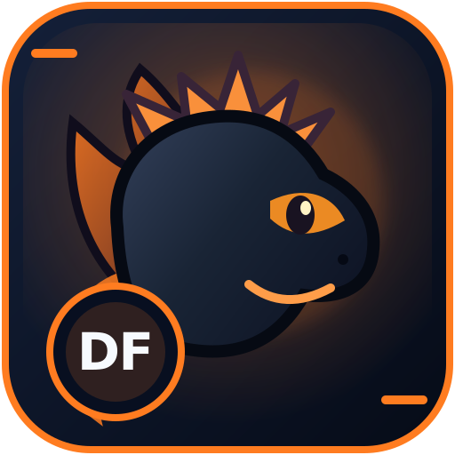

# DragonForge design system — first GitHub rollout



The DragonForge mascot family uses a black dragon with bright orange eyes.
Every repository receives a matching vector icon with its own accent colour
and small project badge. This is **design work**, not a runtime upgrade or
a claim that any project is finished.

## Assets in this repository

- [repository-dragon.svg](repository-dragon.svg): the scalable DragonForge icon, suitable for repository documentation and optional application packaging after review
- [repositories.json](repositories.json): manifest covering **31 public** repositories in the owner's GitHub inventory on 2026-10-18; accent colours and two-/three-character badges
- [DragonForge terminal theme](../../internal/tui/theme/dragonforge.go): selectable dark/light adaptive `dragonforge` theme; does not overwrite existing themes or change the default

## Design language

| Role | Colour |
| --- | --- |
| DragonForge flame orange | `#ff7c20` |
| Coding blue | `#19b6f4` |
| AI violet | `#ad7eff` |
| Reverse engineering cyan | `#30d1d5` |
| N64 / console tools green | `#4ad59c` |
| Creative writing pink | `#f071b6` |
| Game projects gold | `#e9ac46` |

## GitHub rollout

Individual icons are proposed using separate branding branches and PRs in the
owner's **non-empty** repositories. Their common proposed location is:

`docs/branding/repository-dragon.svg`

These PRs are deliberately scoped to **one new SVG per repository**. They do
not change READMEs, upstream copyright notices, application logos, binaries,
GitHub social previews, CI or runtime code. GitHub does not automatically set
its repository avatar/social preview from an SVG committed into the source tree.

Private repository names are omitted from this public registry, even though their\nicon PRs may exist in those private repositories.\n\nA private repository without an initial commit is **not** initialized merely
for this branding rollout. Existing private repositories remain private.

## Using a proposed icon in a repository README (optional)

```markdown

```

Only add this reference after its corresponding icon PR is accepted. Avoid
replacing third-party marks, user data or protected project artwork without
deliberate review.

## Terminal theme

The registered `dragonforge` theme can be selected from DragonForge's
existing interactive theme selector. It is not a desktop GUI and does not
install icon packages on Ubuntu automatically.

Security and agent permissions are unchanged by these design-only updates;
see [SECURITY.md](../../SECURITY.md).
